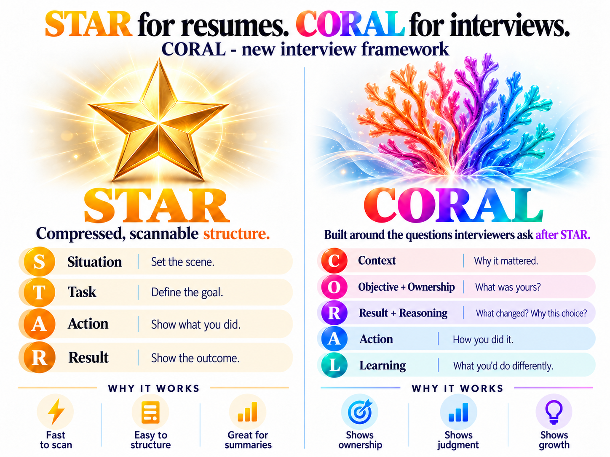

# CORAL

**CORAL is built around the questions interviewers ask after STAR.**

[Amazon](https://amazon.jobs/content/en/how-we-hire/sde-ii-interview-prep) asks why you made your decisions. [Microsoft](https://careers.microsoft.com/v2/global/en/hiring-tips/interview-tips.html) asks what you learned. [Atlassian](https://www.atlassian.com/company/careers/resources/interviewing/engineering) explores trade-offs. An [interviewing expert writing for LinkedIn](https://www.linkedin.com/business/talent/blog/talent-acquisition/what-did-candidate-actually-do) asks what you personally contributed.

STAR is great and gives you a way to organize what happened.  
CORAL prepares you to explain **what you were trying to achieve, what was yours, why you made your decisions, what changed, and what you learned**.



## The framework

STAR uses **Situation → Task → Action → Result** to make experience concise and easy to scan.  
**CORAL** is designed for interviews, where the questions usually go beyond the outline of the story.

| CORAL | The question to prepare |
| --- | --- |
| **C - Context** | What does the interviewer need to know to understand the story? |
| **O - Objective + Ownership** | What were you trying to achieve, and what part was yours? |
| **R - Result + Reasoning** | What happened, and why did you choose that approach? |
| **A - Action** | What did you actually do? |
| **L - Learning** | What did you learn, and what would you change? |
<br>

**Why CORAL makes sense for interviews:**<br>
- **Objective + Ownership:** Ownership comes up constantly in job postings. Companies want people who can take responsibility and deliver. Show what you set out to achieve and how much of it you actually owned.

- **Result first:** Humans want to know the best thing you achieved. Share the result first, and now they're interested in how you made it happen.

- **Reasoning + Action:** STAR tells you what someone did. Interviews go deeper because employers want to know how you think. Why did you choose that approach? What alternatives did you consider? How did you make it work?

- **Learning:** Relevant experience matters because you've already figured things out. Show what you've learned from doing similar work and how that will help you perform better and faster in your next role when compared to the next candidate.

These aren't hypothetical priorities. [LinkedIn](https://www.linkedin.com/business/talent/blog/talent-acquisition/what-did-candidate-actually-do) discusses individual contribution, [Atlassian](https://www.atlassian.com/company/careers/resources/interviewing/engineering) evaluates technical judgment, and [Microsoft](https://careers.microsoft.com/v2/global/en/hiring-tips/interview-tips.html) explicitly recommends reflection.

## Try it

Install the free skill for your agent (Python 3.10+, no external packages):

```bash
python coral.py install --agent codex   # or claude, cursor
```

Then ask your agent:

> Use CORAL. I'll describe something I worked on. Ask me what you need, then prepare an interview story, a resume bullet, or both.

**A resume isn't required.** Start with a bullet, rough notes, or a quick description. CORAL asks about the missing details, then writes the version you need. If you want both, it uses the same story facts for each. If you don't have precise metrics, it can help work out estimates from real inputs and label them clearly.

**Optional: keep a local story record.** The CLI saves structured JSON, checks it against the [story format](story.schema.json), and exports STAR and CORAL from the same record:

```bash
python coral.py new my-story
# Have your agent fill coral-stories/my-story.json from your answers.
python coral.py validate coral-stories/my-story.json
python coral.py render coral-stories/my-story.json --format both --out coral-stories/my-story.md
```

For other assistants, give them [SKILL.md](SKILL.md) directly. The skill works as conversation instructions online; writing local files requires an agent with file access. The CLI works locally without telemetry or network calls. Validation checks the file format and estimate metadata, not whether an achievement actually happened. Existing files are not overwritten without permission.

## More evidence

[GitLab's interviewer handbook](https://handbook.gitlab.com/handbook/hiring/conducting-a-gitlab-interview/) asks whether results were measured and met expectations. A [candidate on Reddit](https://www.reddit.com/r/CareerAdvicePH/comments/1u86ifk/i_either_ramble_or_sound_rehearsed_in_interviews/) struggled with follow-ups about ownership and what they'd do differently. A [self-described former Amazon interviewer](https://www.reddit.com/r/AmazonManagers/comments/1wk5ags/i_interviewed_150_candidates_at_amazon_the_most/) describes looking for evidence of individual decisions and rejected alternatives (self-reported account).

The [skill](SKILL.md) handles the questions; [`coral.py`](coral.py) handles installation, local files, validation, and export. Run `python -m unittest discover -s tests -v` to check the tool. MIT licensed.
